# Entrega del rediseño del frontend (12 nov 2026)

Resumen para la revisión de Iván y la prueba con los directivos de Key. El plan completo está en [`PLAN.md`](../PLAN.md) y cada decisión tiene su ADR (índice en [`docs/README.md`](../README.md)).

## Qué cambió

| Antes | Ahora |
| :--- | :--- |
| Una sola pantalla que cambiaba por estado: recargar volvía al login | Una URL por pantalla (`/`, `/entrar`, `/inicio/…`, `/examen/:clave`, `/resultados/:id`, `/docente`); recargar y «Atrás» funcionan |
| Marca propia «K-test PAA by Key Institute», azul marino y celeste | Producto de Key Institute: logo de Key + K-TEST, negro, blanco y azul Key `#006DFF`, Albert Sans |
| Sin página pública: se abría directo en el login | Landing con foto real, beneficios, «¿Por qué estudiar en Key?» y el enlace a Admisiones 2027 |
| Portal pesado: banner oscuro, pestañas grandes, tarjetas con sombra | Estilo de líneas de Key en toda la plataforma: bordes finos, formas rectas, solo los botones en pastilla y **una acción protagonista** por pantalla |
| Pedía el ciclo de admisión la primera vez | Se quitó: no hace falta para practicar |
| Sin pruebas de interfaz ni CI | ESLint, Vitest, Playwright (escritorio y celular) y CI en cada PR; revisión automática de accesibilidad (axe, WCAG AA) y de foco con teclado |

## Capturas

Escritorio a 1440×900 y celular a 390×844. Se regeneran con `node scripts/capturas.mjs despues http://localhost:5173` (el «antes» necesita levantar `main` anterior con `VITE_ENABLE_DEMO_ACCOUNTS=true`).

| Pantalla | Antes | Después |
| :--- | :--- | :--- |
| Landing | (no existía) | 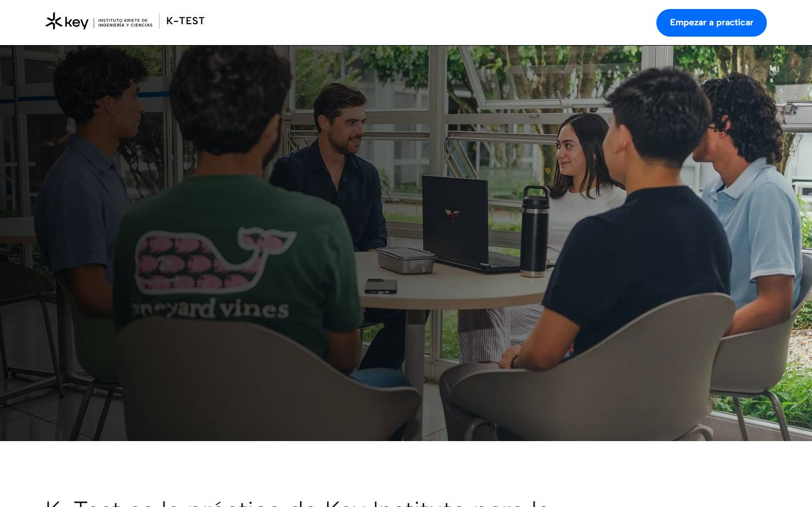 |
| Acceso | 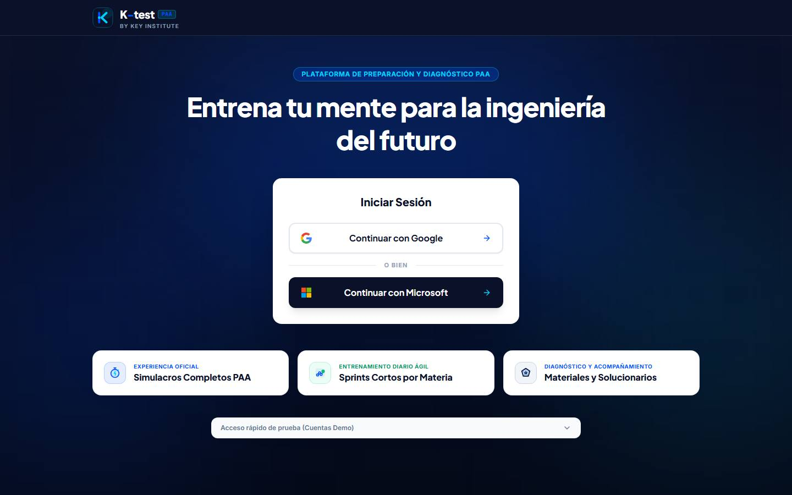 | 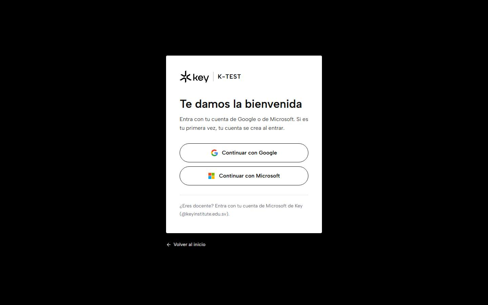 |
| Inicio del estudiante | 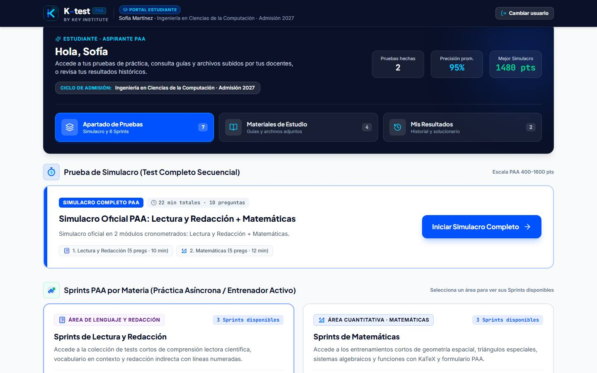 | 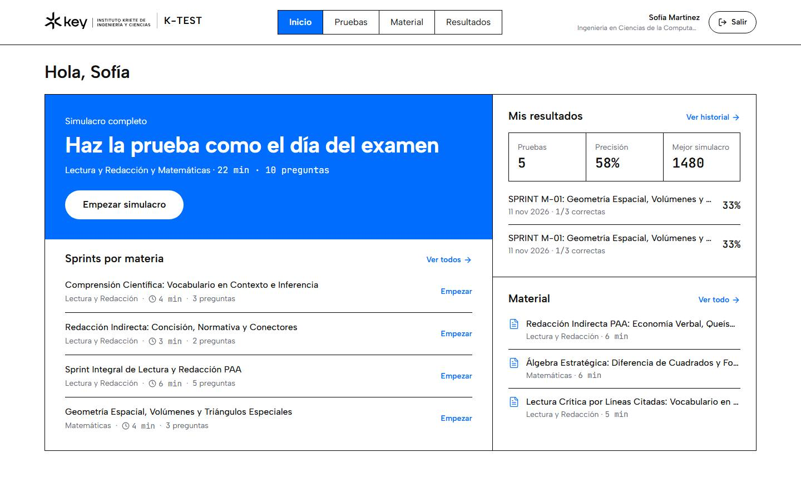 |
| Examen | 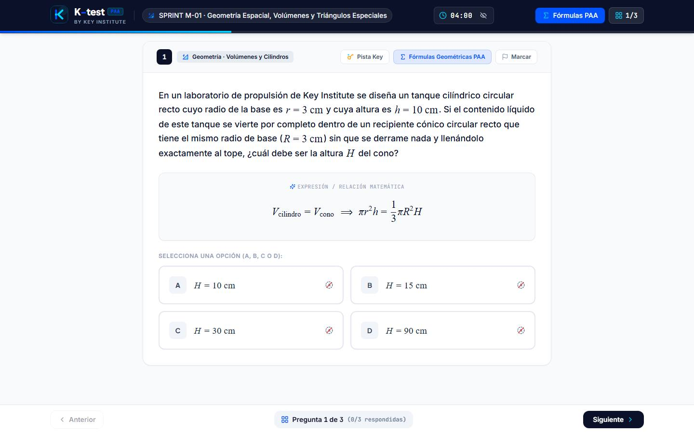 | 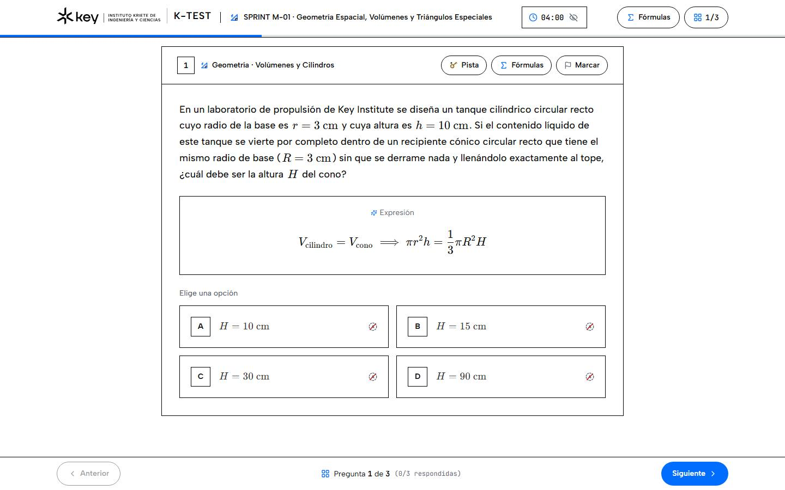 |
| Solucionario | 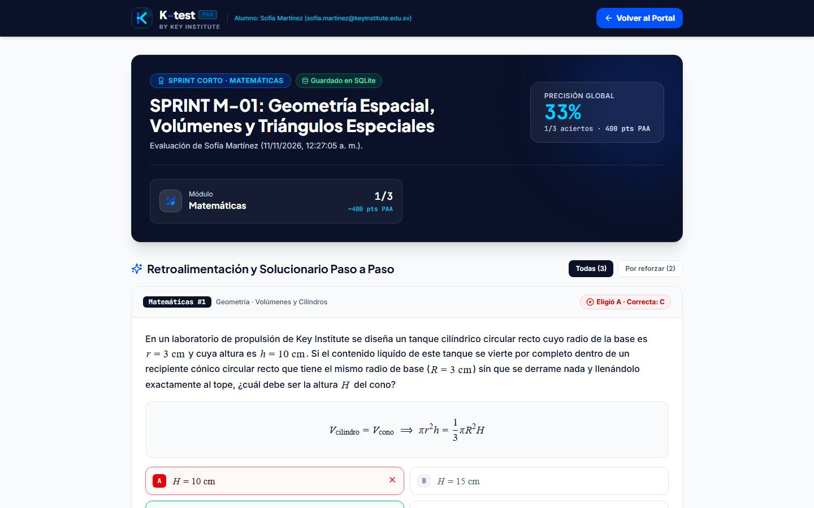 | 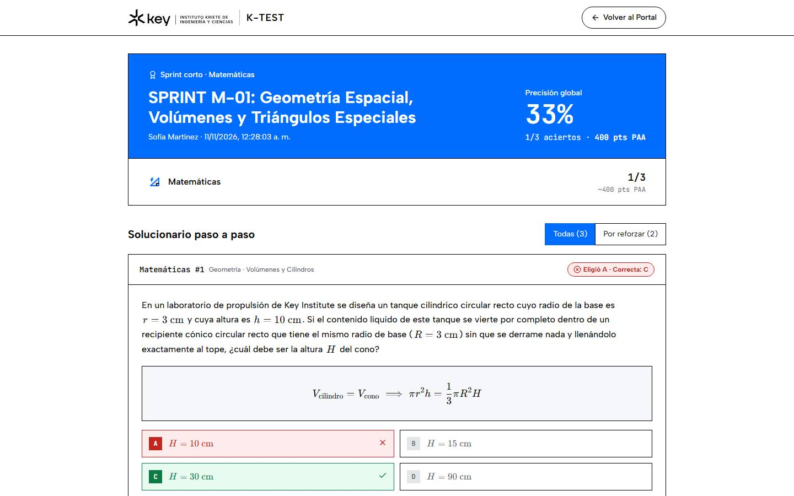 |
| Portal del docente | 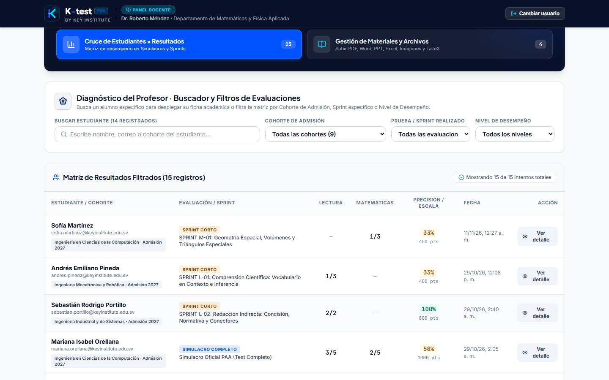 | 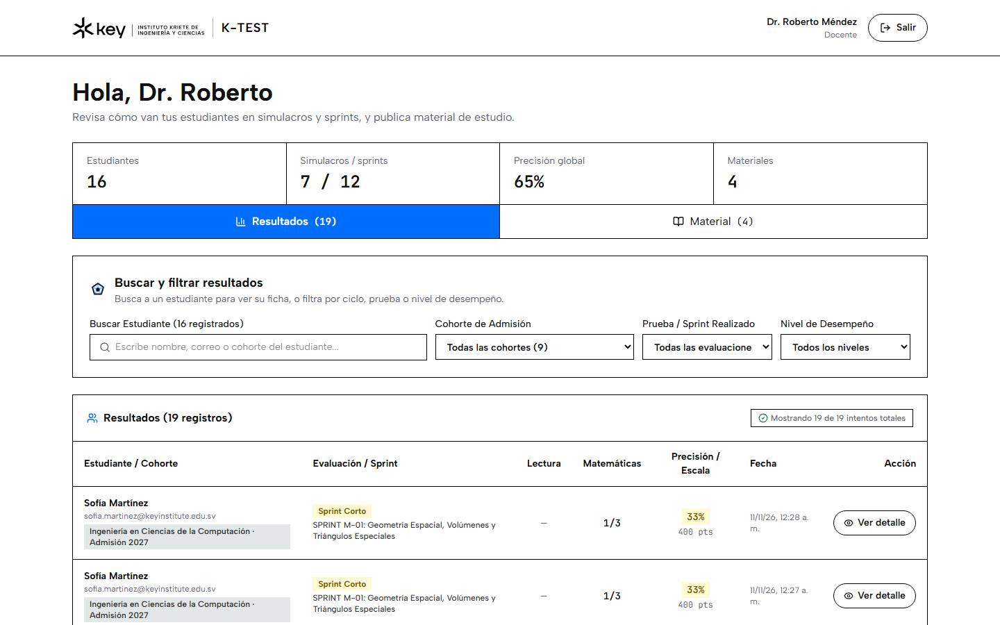 |

En celular, las mismas pantallas están en `capturas/*-celular.jpg`.

## Cómo se revisó

- **Pruebas:** lint, typecheck, Vitest, la prueba de la API y Playwright en escritorio y celular (Pixel 7) pasan en CI.
- **Accesibilidad:** `e2e/accesibilidad.spec.ts` corre axe (WCAG 2.1 A y AA) en todas las pantallas y recorre con Tab el inicio, el examen y el portal del docente: cada elemento que recibe foco lo muestra. Lo que encontró se corrigió (azul sobre gris claro, nombre del botón del mapa de preguntas, vista previa del material sin acceso con teclado).
- **Anchos:** nada se sale de la pantalla de 320 a 1440 px (pruebas en `e2e/`).

## Pendientes

- **Login único** con el portal de admisiones de Key: requiere a TI de Key. Por ahora, Google y Microsoft.
- **Fotos oficiales y visto bueno de Key** para usar su logo, textos y fotos. Una foto que no se podía usar quedó en el historial de git.
- **Filtro por ciclo del docente:** el estudiante ya no elige ciclo, así que los nuevos aparecen sin ciclo. ¿Se quita el filtro o el ciclo viene del portal de admisiones?
- **`SPEC.md`** describe otro stack (React 19, Supabase, Zustand): hay que actualizarlo.
- **`data/paa_platform.sqlite` está en git** y cambia al usar la app en local; conviene sacarlo y crear la base desde un script.
- **Lint del backend** (`server/`, `scripts/`) y los `any` que quedan en `src/` (avisos, no errores).
- **Rediseño a fondo** del examen y del portal docente (por pantallas y rutas, como el del estudiante): quedó fuera del jueves.
